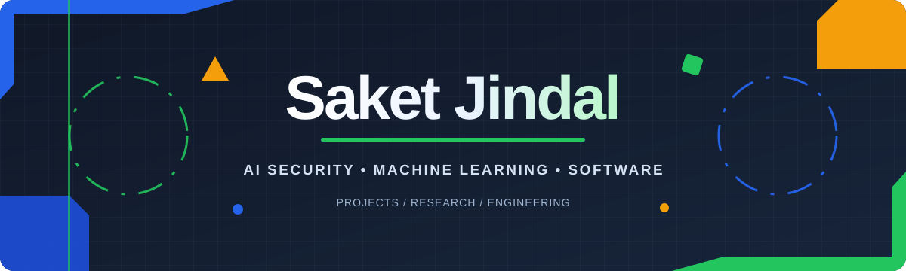

 

---

## Profile

I work across **artificial intelligence, cybersecurity, and software engineering**, with a focus on security evaluation for AI systems, adversarial machine learning, and dependable software.

My interests include model robustness, vulnerability assessment, AI application security, and building practical tools that translate research into usable systems.

## Technical Skills

**Programming & AI**

**Infrastructure & Development**

**Databases & Application Development**

## Selected Projects

<table>
  <tr>
    <td width="50%" valign="top">
      <h3><a href="https://github.com/saketjndl/Sylo">Sylo SDK</a></h3>
      

      
<strong>Creator & Lead Maintainer</strong>

      
An operating layer for AI agents with checkpoint recovery, approval gates, audit logging, and framework integrations.

    </td>
    <td width="50%" valign="top">
      <h3><a href="https://github.com/saketjndl/StillSound-Studio/releases">StillSound Studio</a></h3>
      

      
<strong>Creator & Lead Maintainer</strong>

      
A desktop utility that coordinates playback between YouTube and Spotify.

    </td>
  </tr>
  <tr>
    <td width="50%" valign="top">
      <h3><a href="https://github.com/hypssprojectexhibition-dev/Aegis-Protocol">Aegis Protocol</a></h3>
      
<strong>Co-Creator & Core Contributor</strong>

      
An image security application covering steganographic watermarking, visual cryptography, and automated sensitive-data redaction.

    </td>
    <td width="50%" valign="top">
      <h3><a href="https://torquex-autos.vercel.app/">TorqueX Autos</a></h3>
      
<strong>Co-Founder</strong>

      
An automotive platform featuring industry news, vehicle analytics, comparisons, and vehicle discovery.

    </td>
  </tr>
  <tr>
    <td width="50%" valign="top">
      <h3><a href="https://github.com/saketjndl/VCHOP-by-sodiumcyanide">VCHOP</a></h3>
      
<strong>Lead</strong>

      
Browser security research and API request interception.

    </td>
    <td width="50%" valign="top">
      <h3>Mylo</h3>
      
<strong>Founder & Architect</strong> · <em>IPR process</em>

      
A Python-based browser architecture with a focus on security.

    </td>
  </tr>
  <tr>
    <td colspan="2" valign="top">
      <h3>Purple Pipeline</h3>
      
<strong>Researcher</strong>

      
Methods and tooling for adversarial evaluation of machine learning deployments.

    </td>
  </tr>
</table>

## Experience

| Organization / Area | Work |
|:--|:--|
| **Snorkel AI**  via Airdawg Labs | Contributions to Project Terminus, Marlin, and Tuna. |
| **Law Enforcement Technology** | Developed systems to support the identification and tracking of digital hoax threats. |
| **Full-Stack Engineering** | Designed and deployed applications including Occazio and Fall Guardian. |

## Research

  
  
  
  

**AI-Powered Farming Assistance Using Machine Learning Models**

Accepted for publication in IJACEN.

## GitHub Activity

  

---

SAKET JINDAL · AI · SECURITY · SOFTWARE ENGINEERING

