<p align="center">
  
</p>

<p align="center">
  <a href="https://www.linkedin.com/in/saket-jindal/">LinkedIn</a> &nbsp;·&nbsp;
  <a href="mailto:saketjndl2005@gmail.com">Email</a> &nbsp;·&nbsp;
  <a href="https://github.com/saketjndl/Resume/blob/main/Saket_jindal_resume.pdf">Resume</a> &nbsp;·&nbsp;
  <a href="https://saketjindal.xyz">saketjindal.xyz</a>
</p>


Securing the intersection of **Machine Learning** and **Systems Architecture**. My work focuses on applying AI and machine learning to cybersecurity. I design systems that automate offensive and defensive security workflows, enabling large-scale vulnerability discovery, adversarial testing, and automated purple teaming.


```
languages   python · c# · dart
ml          pytorch
backend     fastapi · postgresql · mongodb
infra       docker · github actions · linux
apps        flutter · unity
```


**[Sylo SDK](https://github.com/saketjndl/Sylo)** &ensp;<sub>Creator & Lead Maintainer</sub><br>
Production operating layer for AI agents featuring checkpoint recovery, approval gates, audit logging, and framework integrations.<br>
[](https://pepy.tech/projects/sylo-sdk)

**[StillSound Studio](https://github.com/saketjndl/StillSound-Studio/releases/tag/v3.0.0)** &ensp;<sub>Creator & Lead Maintainer</sub><br>
Pause YouTube. Play Spotify. Automatically.<br>
[](https://github.com/saketjndl/StillSound-Studio/releases)

**[Aegis Protocol](https://github.com/hypssprojectexhibition-dev/Aegis-Protocol)** &ensp;<sub>Co-Creator & Core Contributor</sub><br>
AI-powered image security suite for steganographic watermarking, visual cryptography, and automated sensitive data redaction.

**[TorqueX Autos](https://torquex-autos.vercel.app/)** &ensp;<sub>Co-Founder</sub><br>
Automotive media & intelligence platform delivering industry news, vehicle analytics, comparisons, and discovery tools.

**[VCHOP](https://github.com/saketjndl/VCHOP-by-sodiumcyanide)** &ensp;<sub>Lead</sub><br>
Browser security & API interception logic.

**Mylo** &ensp;<sub>Founder & Architect</sub><br>
Python-based secure browser architecture (IPR Phase).

**Purple Pipeline** &ensp;<sub>Researcher</sub><br>
Automated adversarial testing for ML deployments.


* **Snorkel AI (via Airdawg Labs):** Contributing to *Project Terminus*, *Marlin*, and *Tuna*.
* **Law Enforcement Tech:** Developed identification systems for tracking digital hoax threats.
* **Architecture:** Deployed scalable full-stack ecosystems including *Occazio* and *Fall Guardian*.

<p align="center">
  
</p>
